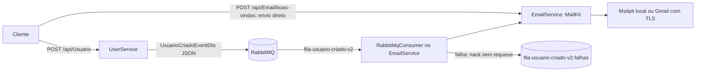

# Arquitetura

Atividade baseada em [rannyer/AuthApp](https://github.com/rannyer/AuthApp). Objetivo: receber um cadastro e enviar boas-vindas por SMTP, usando mensageria.

| Componente | Responsabilidade |
| --- | --- |
| UserService | Controller HTTP, validação, geração de ID/data e publicação |
| Shared | DTO do evento e definição compartilhada das filas |
| RabbitMQ | Transportar e armazenar mensagens até o processamento |
| EmailService | API de teste direto, consumidor IHostedService e envio SMTP |
| MailKit/MimeKit | Conexão, autenticação, TLS e mensagem MIME |

## Fluxo

1. O controller valida nome e e-mail.
2. UsuarioService gera UUID/data UTC; não grava em banco.
3. O produtor publica mensagem persistente em fila durável com confirmação do broker. O HTTP retorna 202 após a publicação.
4. O consumidor recebe uma mensagem por vez, desserializa e valida o evento.
5. ProcessarBoasVindasAsync monta a mensagem e aguarda aceitação SMTP.
6. Somente após esse aceite, confirma a mensagem no RabbitMQ. Falhas são rejeitadas sem recolocação e encaminhadas para a fila de falhas.

O envio direto usa o mesmo método SMTP, mas não passa pela fila. Sucesso SMTP não comprova recebimento na caixa do usuário.

## Decisões

- Registrados e mapeados os controllers do UserService, ausentes na inicialização original.
- Substituída a simulação por envio SMTP assíncrono com cancelamento e timeout.
- Cadastro retorna 202, pois não existe persistência ou GET para consultar o ID. O CreatedAtAction original apontava para outra chamada POST.
- Fila v2 evita redeclarar a fila original não durável com atributos diferentes. Mensagens antigas não são migradas automaticamente.
- Fila de falhas substitui repetição infinita de erros. O reprocessamento é manual pelo painel, após corrigir a causa.
- Configurações SMTP externas, validadas na inicialização; TLS obrigatório fora do ambiente local e em qualquer login SMTP.

## Limites

Apesar do nome AuthApp, não há login, senha, JWT, autorização ou banco de usuários. As rotas estão abertas para a atividade local; antes de exposição pública, proteger especialmente o envio direto.

Não há Outbox, deduplicação persistente ou garantia de envio único. Uma queda entre o aceite SMTP e o ACK pode gerar duplicidade. Não há retentativa automática para eventos na fila de falhas. Para produção, avaliar persistência, Outbox, idempotência, retentativas e monitoramento.

O RabbitMQ precisa estar disponível ao iniciar o EmailService. Serviços são processos separados que compartilham contratos, sem chamadas HTTP entre si.

Referência: [RabbitMQ — Work Queues .NET](https://www.rabbitmq.com/tutorials/tutorial-two-dotnet).
