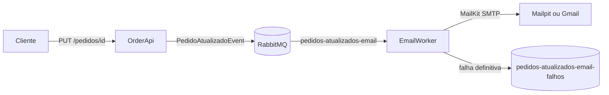

# Pedidos com EmailWorker e RabbitMQ

Atividade de 19/10/2026 baseada em [rannyer/EcommereceMicroservices](https://github.com/rannyer/EcommereceMicroservices): enviar email com os dados de cada atualizacao de pedido, usando mensageria.



## Stack

C# / .NET 8, ASP.NET Core Minimal API, RabbitMQ.Client 7.2.2, MailKit 4.17.0 e MimeKit, System.Text.Json, Swashbuckle 6.6.2, xUnit 2.9.3 e Docker Compose. O armazenamento de pedidos e em memoria.

## Executar

Com Docker Desktop ativo e runtime .NET 8 instalado:

```powershell
dotnet restore EcommereceMicroservices.sln
dotnet build --no-restore
dotnet test Tests/Tests.csproj --no-restore
docker compose -p aula-email up -d
dotnet run --project OrderApi --launch-profile http
```

Em outro terminal:

```powershell
dotnet run --project EmailWorker
```

Swagger em http://localhost:5109/swagger. Mailpit em http://localhost:8025. RabbitMQ em http://localhost:15672 com guest / guest. Os composes de AuthApp e desta atividade usam as mesmas portas: reutilize a infraestrutura ou execute um por vez.

O NotifcationWorker original continua disponivel, opcionalmente, para consumir criacao de pedidos em pedidos-queue. Ele nao disputa a fila de atualizacao do EmailWorker.

## Endpoints

| Metodo e rota | Entrada | Sucesso | Erros previstos |
| --- | --- | --- | --- |
| POST /pedidos | clienteNome, clienteEmail, valorTotal | 202 com status e pedido | 400 dados invalidos |
| GET /pedidos/{id} | UUID na rota | 200 com pedido | 404 inexistente |
| PUT /pedidos/{id} | status, valorTotal | 200 com pedido atualizado | 400 dados invalidos; 404 inexistente |

Nome e email valido obrigatorios; valor nao negativo. Status obrigatorio com ate 100 caracteres. Falhas de publicacao nao retornam sucesso. Nao ha autenticacao.

```powershell
$novo = Invoke-RestMethod http://localhost:5109/pedidos -Method Post `
  -ContentType application/json -Body '{"clienteNome":"Aluno","clienteEmail":"aluno@example.com","valorTotal":149.90}'
$id = $novo.pedido.pedidoId
Invoke-RestMethod "http://localhost:5109/pedidos/$id" -Method Put `
  -ContentType application/json -Body '{"status":"Enviado","valorTotal":159.90}'
```

O email inclui nome, identificador do pedido, status anterior e atual, valor, data UTC e ID do evento. Exemplos tambem em OrderApi/OrderApi.http.

## Gmail e configuracao

O EmailWorker usa variaveis RabbitMq__Uri e Smtp__Host, Smtp__Port, Smtp__Security, Smtp__From, Smtp__User e Smtp__Password. Padrao local: RabbitMQ localhost:5672 e SMTP localhost:1025 sem login.

Para Gmail: smtp.gmail.com, porta 587, StartTls e remetente/usuario da conta Google; senha de aplicativo configurada privadamente. Na porta 465, usar SslOnConnect. Veja as instrucoes de conta e referencias em [configuracao Gmail do AuthApp](../AuthApp/docs/stack-e-configuracao.md).

Credenciais de nuvem presentes no codigo original foram substituidas por configuracao local; continuam no historico do professor. Nenhuma delas foi usada nos testes.

## Garantias e limites

Filas duraveis, mensagens persistentes e confirmacao do broker na publicacao. ACK apenas apos aceite SMTP. Ate tres tentativas para falhas de transporte SMTP previstas; falhas definitivas vao para a fila de falhas, com reprocessamento manual.

Pedidos desaparecem ao reiniciar. Publicar antes de atualizar a memoria evita alterar estado quando a publicacao falha, mas nao cria transacao entre estado e evento. Para producao, usar banco e considerar Outbox. Atualizacoes sao serializadas no processo.

Uma queda entre aceite SMTP e ACK pode duplicar emails. Nao ha deduplicacao persistente, garantia de entrega final ou validacao de transicoes de status. O broker precisa estar disponivel quando o worker iniciar. Uso didatico local.

Veja [validacao](docs/validacao.md) e [praticas aprendidas](docs/padroes-da-atividade.md).
