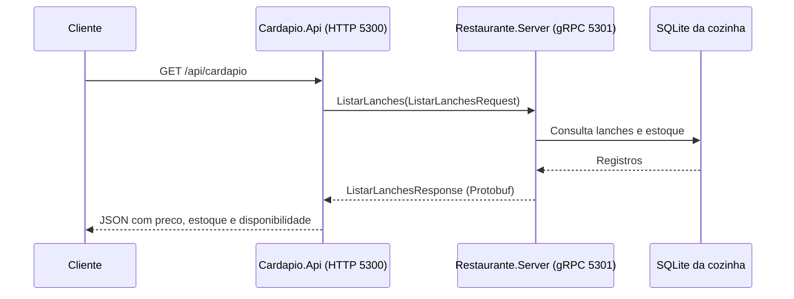

# Lanchonete — cozinha e vitrine via gRPC

Implementação do cenário informado pelo aluno: Restaurante.Server mantém os lanches/estoque; Cardapio.Api consulta a cozinha diretamente por gRPC para montar o cardápio HTTP.



## Componentes e responsabilidades

| Projeto | Papel |
| --- | --- |
| Restaurante.Server | Serviço gRPC da cozinha; cria e consulta SQLite; mantém estoque |
| Cardapio.Api | Vitrine HTTP/JSON; cliente gRPC; calcula disponibilidade e converte centavos para decimal |
| Contratos/restaurante.proto | Contrato compartilhado, usado para gerar servidor e cliente |
| Tests | Executor de integração com processos reais, portas dinâmicas e banco temporário |

O SQLite pertence somente à cozinha. A API de vitrine recebe sua informação pela chamada gRPC. É uma consulta que aguarda resposta; não usa a fila de eventos das atividades de email.

## Contrato

Serviço Cozinha, package restaurante, namespace C# Lanchonete.Grpc:

- ListarLanches retorna uma lista com id, nome, preco_centavos e estoque.
- AtualizarEstoque recebe lanche_id e quantidade absoluta. Quantidade permitida: 0 a 1.000.000; ID deve ser positivo. Retorna o lanche atualizado.
- Id/quantidade inválidos: gRPC InvalidArgument. ID inexistente: NotFound.

Campos numerados no proto são parte do contrato. O preço usa int64 em centavos; por exemplo, 2250 representa R$ 22,50. A API expõe preco decimal e também precoCentavos, sem usar float para o valor monetário.

## Executar

Requisito: SDK .NET 10. Na pasta Lanchonete:

```powershell
dotnet restore Lanchonete.sln
dotnet build Lanchonete.sln --no-restore
```

Terminal 1, na mesma pasta:

```powershell
dotnet run --project Restaurante.Server
```

Terminal 2:

```powershell
dotnet run --project Cardapio.Api --launch-profile http
```

Abra [Swagger da vitrine](http://localhost:5300/swagger) ou [cardápio JSON](http://localhost:5300/api/cardapio). Não precisa de Python nem Docker nesta atividade.

O servidor gRPC escuta em 127.0.0.1:5301 com HTTP/2 sem TLS, exclusivamente para o exemplo local. Navegadores comuns não são o cliente desse endpoint gRPC. A vitrine escuta HTTP na porta 5300.

O banco inicial contém X-Salada (2250 centavos, estoque 10), X-Bacon (2990, estoque 5) e Vegetariano (2590, estoque 0). O seed ocorre apenas quando a tabela está vazia. Reiniciar a cozinha preserva alterações já salvas.

## Endpoints da vitrine

| Rota HTTP | Resultado |
| --- | --- |
| GET /api/cardapio | 200 com quantidade e itens; inclui esgotados com disponivel=false |
| GET /api/cardapio?somenteDisponiveis=true | 200 filtrando estoque maior que zero |
| GET /health | 200 se a vitrine está ativa; não verifica a cozinha |
| GET /swagger | Interface de documentação em Development |

Exemplo de item:

```json
{"id":1,"nome":"X-Salada","preco":22.50,"precoCentavos":2250,"estoque":10,"disponivel":true}
```

Cozinha indisponível: HTTP 503. Deadline gRPC excedido: 504. Outros erros gRPC: 502. O cancelamento da requisição é enviado para a chamada gRPC; o servidor repassa o token às operações EF Core. Cada consulta tem deadline de três segundos. O canal gRPC é reutilizado pelo contêiner de DI.

AtualizarEstoque é uma operação gRPC da cozinha, para manutenção interna; não é um endpoint público da vitrine. O executor de testes faz essa chamada e comprova que a próxima consulta HTTP mostra a alteração.

## Configuração

| Serviço | Variável | Padrão |
| --- | --- | --- |
| Cozinha | Grpc__Port | 5301 |
| Cozinha | Database__Path | data/estoque.db, relativo ao diretório de trabalho |
| Vitrine | Cozinha__Url | http://127.0.0.1:5301 |

Para executar em outra porta, configure Grpc__Port na cozinha e Cozinha__Url na vitrine. A cozinha configura Listen explicitamente com HTTP/2; mudar apenas --urls não substitui esse endpoint.

## Testes

Na pasta Lanchonete, depois de compilar toda a solução:

```powershell
dotnet run --project Tests --no-build
```

O executor retorna 0 em sucesso e 1 em falha. Inicia os dois serviços em portas temporárias e encerra somente os processos que criou. Usa SQLite temporário e não altera o estoque da demonstração. Verifica oito cenários: listagem gRPC, JSON/preço HTTP, filtro, atualização refletida na vitrine, rejeição de negativo, ID inexistente, persistência após reinício e HTTP 503 com a cozinha parada.

## Stack e decisões

.NET 10, ASP.NET Core gRPC, Grpc.AspNetCore/Grpc.Net.Client/Grpc.Tools 2.66.0, Google.Protobuf 3.28.3, EF Core SQLite 10.0.10, SQLitePCLRaw.bundle_e_sqlite3 3.0.3 e Swashbuckle 6.8.1. Versões transitivas registradas nos arquivos packages.lock.json.

Foi acrescentado SQLite para comprovar que o estoque continua salvo após reiniciar. EnsureCreated serve ao esquema inicial didático; evoluções de banco existente exigem migrações planejadas. Quantidade tem validação no RPC e restrição no banco.

Não há pedidos, reserva/baixa de estoque por venda, autenticação, cache, isolamento de restaurantes ou controle de concorrência por versão. AtualizarEstoque substitui a quantidade, não implementa venda concorrente. Antes de hospedagem pública, configurar TLS e autorização para operações internas.

Referências: [serviços gRPC ASP.NET Core e HTTP/2](https://learn.microsoft.com/en-us/aspnet/core/grpc/aspnetcore?view=aspnetcore-10.0) e [deadline/cancelamento](https://learn.microsoft.com/en-us/aspnet/core/grpc/deadlines-cancellation?view=aspnetcore-10.0).
