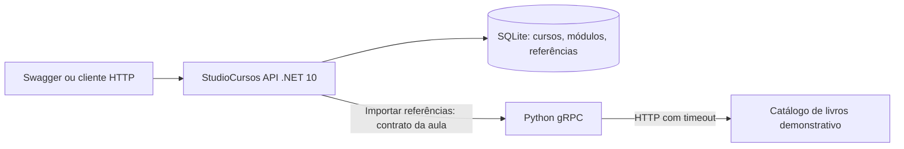
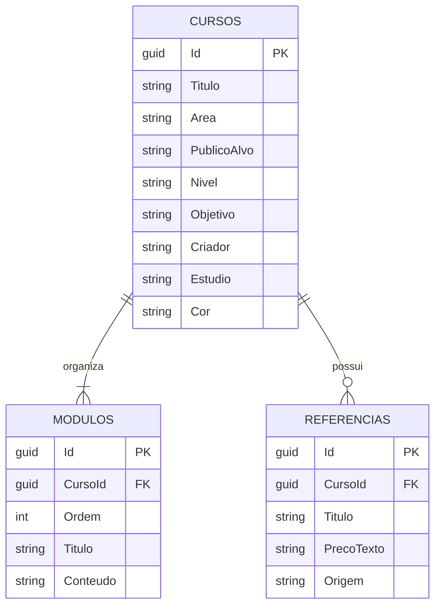

# StudioCursos — um laboratório para ensinar arte

Proposta própria para o exercício aberto da aula de 21/10/2026: evoluir o [ScraperApi do professor](https://github.com/rannyer/ScraperApi) com banco de dados e uma aplicação de domínio. A ideia é organizar cursos que artistas, tatuadores e outros criadores possam personalizar.

## O que esta versão faz

- Cadastra, lista, consulta, edita e exclui cursos.
- Personaliza título, área, público-alvo, nível, objetivo, criador, estúdio e cor.
- Organiza módulos com ordem, título e conteúdo textual.
- Persiste cursos, módulos e referências em SQLite, inclusive após reiniciar a API.
- Importa referências pelo fluxo .NET → gRPC → Python → página HTML e grava no curso, sem duplicar o mesmo título/preço em importações repetidas.
- Mantém cadastro e consulta disponíveis quando o serviço Python está fora do ar; a importação informa falha.

O exemplo de curso fornecido é **Desenho autoral para tatuagem**, com pesquisa, composição e revisão de portfólio. Os campos permitem adaptar a ideia para ilustração, fotografia ou outro ensino. Esta versão entrega API e documentação Swagger; não inclui uma interface de aluno, vídeos, matrícula ou pagamentos.

O scraping usa o catálogo demonstrativo books.toscrape.com da aula. Seus livros não são curadoria pedagógica para tatuadores, e os preços são texto da fonte; a importação demonstra integração e persistência. Ela não produz automaticamente um curso nem copia o conteúdo dos livros.

## Arquitetura e banco





Chaves estrangeiras e exclusão em cascata; ordem de módulos única por curso; índice único para título/preço de referência por curso. A edição dos módulos acontece dentro de transação. O canal gRPC é reutilizado e descartado pelo contêiner de DI; a chamada tem deadline de 10 segundos e recebe cancelamento HTTP. O Python limita o GET externo por timeout e traduz falhas para status gRPC.

## Executar no Windows

Requisitos: SDK .NET 10, Python 3.14 (ambiente validado), PowerShell 7. Não precisa de Docker para esta atividade. Na pasta StudioCursos:

```powershell
pwsh -File Preparar.ps1
```

Terminal 1, na pasta StudioCursos:

```powershell
cd python
.\.venv\Scripts\python.exe server.py
```

Terminal 2, na pasta StudioCursos:

```powershell
dotnet run --project Api --launch-profile http
```

Abra [Swagger](http://localhost:5200/swagger). O SQLite é criado na pasta data do diretório de trabalho da API; não é versionado. O caminho pode ser substituído com Database__Path; PythonGrpc__Url configura o endereço gRPC. O servidor Python usa GRPC_BIND e SCRAPER_URL, ambos configurados pelo operador, sem entrada de URL pelo usuário da API.

Terminal 3, na pasta StudioCursos, para cadastrar a proposta de curso:

```powershell
$curso = Invoke-RestMethod http://localhost:5200/api/cursos -Method Post `
  -ContentType application/json -Body (Get-Content exemplos/curso.json -Raw)
Invoke-RestMethod "http://localhost:5200/api/cursos/$($curso.id)"
Invoke-RestMethod "http://localhost:5200/api/cursos/$($curso.id)/referencias/importar" -Method Post
```

## Endpoints

| Método e rota | Resultado |
| --- | --- |
| GET /health | 200, processo ativo; não é health check das dependências |
| GET /api/cursos | 200, até 100 cursos com totais de módulos/referências |
| POST /api/cursos | 201 e Location; 400 para campos/módulos inválidos |
| GET /api/cursos/{id} | 200 com detalhes; 404 inexistente |
| PUT /api/cursos/{id} | 200; substitui metadados e todos os módulos; 400 ou 404 |
| DELETE /api/cursos/{id} | 204 com cascata; 404 inexistente |
| POST /api/cursos/{id}/referencias/importar | 200 com adicionadas/total; 404 inexistente; 409 em conflito de gravação; 502 resposta inválida; 503 dependência indisponível; 504 deadline |

Payload completo em exemplos/curso.json. Todos os campos textuais do curso são obrigatórios; cor no formato #RRGGBB; 1 a 30 módulos com ordens positivas distintas. O endpoint PUT não substitui as referências já importadas. Datas são UTC.

## Testes

Depois de Preparar.ps1, na pasta StudioCursos/python:

```powershell
.\.venv\Scripts\python.exe -m unittest -v test_server test_integracao
```

Os testes de integração iniciam API .NET, servidor gRPC e fonte HTTP local, usam um SQLite temporário e encerram os processos que criaram. Verificam persistência depois de reinício, importação repetida, atualização, erros e cascata. Não dependem da internet nem de livros reais para passar. Veja docs/validacao.md para os resultados executados.

## Stack e versões

.NET 10 / C#; EF Core SQLite 10.0.10; SQLitePCLRaw.bundle_e_sqlite3 3.0.3; Google.Protobuf 3.28.3, Grpc.Net.Client/Grpc.Tools 2.66.0 e Swashbuckle 6.8.1. Versões Python e transitivas fixadas em python/requirements.txt a partir do ambiente instalado. Contrato original preservado em contratos/produto.proto; os dois clientes são gerados desse mesmo arquivo.

O bundle SQLite foi atualizado explicitamente após a auditoria apontar a biblioteca nativa transitiva antiga. Referências: [EF SQLite](https://learn.microsoft.com/en-us/ef/core/providers/sqlite/), [bundle 3.0.3](https://www.nuget.org/packages/SQLitePCLRaw.bundle_e_sqlite3/3.0.3) e [alerta encontrado](https://github.com/advisories/GHSA-2m69-gcr7-jv3q).

## Limites e futuro SaaS

MVP local de um catálogo autoral. Nome de criador/estúdio são metadados, não isolamento entre clientes. Não há login, autorização, isolamento multi-tenant, edição simultânea com controle de versão, matrícula, progresso, upload de vídeos, cobrança ou deploy público. As rotas de escrita estão abertas para a demonstração local.

O esquema inicial usa EnsureCreated para facilitar a aula; evoluções de um banco existente precisam de migrações planejadas. O GET externo tem timeout de conexão/leitura, não uma garantia de duração total sob qualquer condição. gRPC sem TLS fica restrito a loopback por padrão.

Para evoluir: validar com um criador real, adicionar autenticação e propriedade dos cursos, depois tenant e testes de isolamento; separar publicação/rascunho e matrícula; só então armazenamento de mídia, progresso, planos e pagamentos. Preservar autoria das referências e permitir curadoria manual. SQLite pode dar lugar a PostgreSQL conforme os requisitos de implantação e concorrência.

## Como apresentar ao professor

1. Mostrar o contrato original e o caminho .NET → Python.
2. Criar o curso de desenho e mudar o nome do estúdio/módulos.
3. Reiniciar a API e comprovar que o curso continua salvo.
4. Importar referências e repetir para mostrar que não duplica.
5. Parar o Python: consultar o curso continua funcionando e a importação retorna erro explícito.
6. Mostrar o modelo relacional, os testes e as diferenças entre exercício e produto SaaS.
