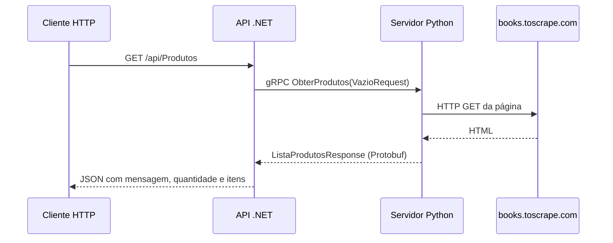

# Aula de 21/10/2026 — análise confirmada e execução

Fontes: capturas e código enviados pelo aluno; [repositório do professor](https://github.com/rannyer/ScraperApi/tree/2860c014ccb6167e8aa02758dcafb43873293dfd), commit `2860c014ccb6167e8aa02758dcafb43873293dfd`, inspecionado localmente. Conversas pessoais e lista de participantes não foram incorporadas.

## Arquitetura



Esta é uma chamada entre serviços que aguarda resposta. As atividades anteriores usam RabbitMQ para processamento assíncrono de eventos. A escolha depende de o solicitante precisar do resultado naquela chamada.

## Stack verificada

| Parte | Tecnologia/configuração |
| --- | --- |
| API | C#, ASP.NET Core, target **net10.0** |
| Protobuf .NET | Google.Protobuf **3.28.3** |
| Cliente gRPC .NET | Grpc.Net.Client **2.66.0** |
| Geração C# | Grpc.Tools **2.66.0**, PrivateAssets=all |
| Inclusão do contrato | Protobuf Include=Protos\produto.proto, **GrpcServices=Client** |
| Pacote Swagger | Swashbuckle.AspNetCore **6.8.1** |
| Servidor Python | grpcio, grpcio-tools, requests, beautifulsoup4; versões não fornecidas |
| Endpoint gRPC | http://localhost:50051, sem TLS no exemplo |
| Coleta | Primeiros cinco livros de http://books.toscrape.com/ |

As versões acima descrevem o material da aula. Não constituem uma recomendação de versões para novos projetos. O requirements.txt do exemplo Python lista dependências sem fixar versões; ainda não é um ambiente reproduzível validado.

## Contrato e endpoint

Contrato completo disponível em [python/produto.proto](python/produto.proto): package produto; serviço ScraperService; operação unária ObterProdutos(VazioRequest) retornando ListaProdutosResponse. ProdutoDto contém titulo (campo 1) e preco (campo 2), ambos string; a lista usa repeated ProdutoDto produtos (campo 1).

API original: **GET http://localhost:5100/api/Produtos**, ou HTTPS na porta 7236 pelo profile https. Em sucesso, JSON com mensagem, quantidade e itens. Cada item tem titulo e preco, que permanece texto coletado. Qualquer exceção capturada pelo controller retorna HTTP 500 com erro genérico.

O arquivo ScraperApi.http original ainda aponta para /weatherforecast, uma rota que não é mapeada no código inspecionado. Use /api/Produtos.

Apesar da dependência Swashbuckle, Program.cs não registra AddSwaggerGen, UseSwagger ou UseSwaggerUI. Não prometer /swagger nesta versão.

## Executar o exemplo

Na raiz de uma cópia deste repositório, usando Python e SDK .NET 10 instalados:

```powershell
cd aulas/2026-10-21-grpc/python
py -m venv .venv
.\.venv\Scripts\python.exe -m pip install -r requirements.txt
.\.venv\Scripts\python.exe -m grpc_tools.protoc -I. --python_out=. --grpc_python_out=. produto.proto
.\.venv\Scripts\python.exe server.py
```

Em outro terminal, em uma pasta de trabalho para baixar a API do professor:

```powershell
git clone https://github.com/rannyer/ScraperApi.git
cd ScraperApi
git checkout 2860c014ccb6167e8aa02758dcafb43873293dfd
dotnet restore
dotnet run --launch-profile http
```

Em um terceiro terminal:

```powershell
Invoke-RestMethod http://localhost:5100/api/Produtos
```

Os três comandos dotnet add package do chat já estão refletidos no csproj; não precisam ser repetidos ao clonar esse commit. Grpc.Tools gera o cliente C# durante o build. O comando protoc acima gera os arquivos Python. Execute ambos a partir do mesmo contrato.

## Práticas e pontos de revisão

| Observação no exemplo | Por que importa | Evolução possível |
| --- | --- | --- |
| Interfaces e DI entre controller, serviço e cliente | Permitem isolar comunicação em testes | Preservar essa separação |
| IConfiguration recebido no construtor do PythonScraperClient | A URL é configurável e a dependência já está injetada no commit examinado | A observação do chat pode referir-se a um estado anterior da aula |
| Requests sem timeout e chamada gRPC sem deadline | A espera pode ficar sem um limite definido | Timeout HTTP e deadline gRPC coerentes; propagar cancelamento |
| Canal gRPC criado e descartado a cada chamada | Aumenta trabalho de criação de conexões | Avaliar canal reutilizado ou client factory com DI |
| HTTP externo diferente de 200 retorna lista vazia | Falha de dependência pode parecer catálogo sem produtos | Verificar status, tratar exceções e definir status gRPC/HTTP apropriados |
| Seletores HTML assumem elementos presentes | Mudança no HTML pode causar exceção | Validar estrutura e testar parsing com HTML de fixture |
| preco é string | Preserva o texto bruto, inclusive símbolo monetário | Se houver cálculos, definir valor e moeda em contrato apropriado |
| Servidor usa [::]:50051 sem TLS | Pode escutar fora do loopback, conforme rede/firewall | Restringir ao ambiente local ou configurar transporte seguro |

Não há evidência no trecho enviado de uma credencial exposta. A mensagem “tá vazando” no chat não permite concluir o que ocorreu.

Referências técnicas: [deadlines gRPC](https://grpc.io/docs/guides/deadlines/), [timeout e erros HTTP em Requests](https://requests.readthedocs.io/en/latest/user/quickstart/#timeouts), [client factory .NET](https://learn.microsoft.com/en-us/aspnet/core/grpc/clientfactory?view=aspnetcore-10.0).

## Estado de validação

Repositório baixado e código inspecionado; contrato confirmado em relação ao texto enviado. O servidor Python do chat foi transcrito com o comportamento preservado (removido apenas o import time sem uso).

Esta rodada não instalou dependências Python, compilou a API nem executou scraping ou chamada gRPC. Os comandos são um roteiro preparado a partir do material. Não foi identificado enunciado de entrega adicional no chat enviado.

## Evolucao implementada depois da analise

A proposta [StudioCursos](../../StudioCursos/README.md) aplica o exercicio aberto do professor a cursos personalizaveis com SQLite. Sua variante do servidor foi compilada/testada em integracao .NET/Python; cinco testes passaram e uma importacao real recebeu cinco livros do site da aula. O codigo original do professor permanece como referencia didatica nesta pasta.
